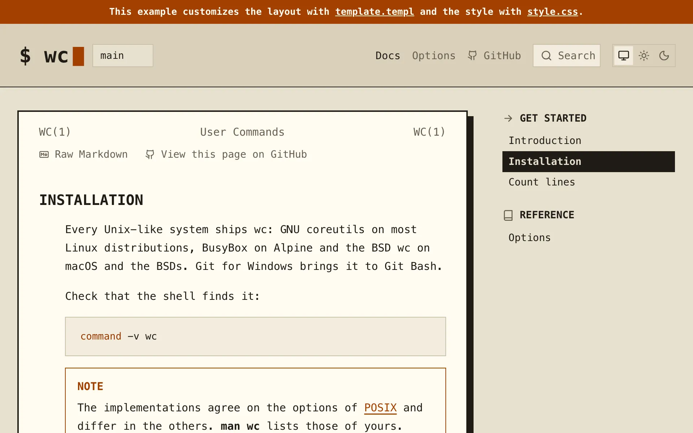
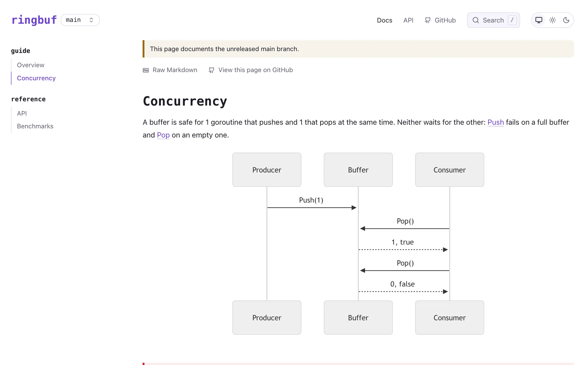

# Examples

The repository has 2 example docs folders, each with a style of its own. Each is deployed as a site, and you can serve it from the root of a clone of the repository.

## A command-line tool

[`example/cli/docs`](../../example/cli/docs/) documents wc, the Unix tool that counts lines, words and bytes, in the style of a man page in a terminal window. See https://romshark.github.io/docpages/example/cli/

<picture>
  <source media="(prefers-color-scheme: dark)" srcset="img/cli-dark.webp">
  
</picture>

It shows:

- A logo, a favicon and an icon for each group
- Callouts and a code block with a title
- A [template](../2-guide/6-templates.md) that builds a page of its own from the parts of docpages, with a banner across the top, links in the header, the navigation right of the text and no contents column
- The text in a window between the title line and the footer line of a man page
- A `style.css` that sets the colors and the fonts, frames the window, shows the contents bar at every width and marks the current page in reverse video
- The indentation, the capitals and the square corners of a man page

```sh title="Terminal"
go run ./cmd/docpages -serve 127.0.0.1:7340 example/cli/docs
```

## A Go library

[`example/library/docs`](../../example/library/docs/) documents ringbuf, a made-up Go ring buffer, in a monospace style. See https://romshark.github.io/docpages/example/library/

<picture>
  <source media="(prefers-color-scheme: dark)" srcset="img/library-dark.webp">
  
</picture>

It shows:

- The name of the project in place of a logo
- A group that its `README.md` opens
- A Mermaid diagram
- A link in the footer with an icon
- Links to the headings of another page
- A `<details>` that opens
- 2 releases, v1.0 and v0.9, whose note sends readers to v1.0
- A [template](../2-guide/6-templates.md#releases) that adds a security banner to the pages of v0.9
- A `style.css` that sets the colors and the fonts

```sh title="Terminal"
go run ./cmd/docpages -serve 127.0.0.1:7340 example/library/docs
```

## This site

The docs of docpages are an example too: a logo, a favicon, images, videos and the colors of [`docs/style.css`](../style.css).
