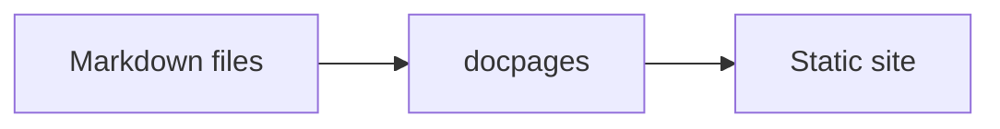

# Writing pages

Pages are GitHub Flavored Markdown. If a page reads well on GitHub, it reads well on the site.

## Front matter

A page can start with YAML front matter between 2 lines of `---`:

```yaml
---
title: Install
suggested: true
---
```

| Key | What it does |
| --- | --- |
| `title` | Replaces the level 1 heading in the navigation and the browser tab. |
| `suggested` | `true` offers the page in the search before you type. |
| `source` | Shows another Markdown file in place of the page, as `../../CHANGELOG.md`. The file stays where it is. |
| `url` | Makes the entry a link to another site, as an API reference. Needs `title`. |

The `README.md` of the docs folder also holds the [site settings](4-site-settings.md). The [reference](../3-reference/2-front-matter.md) lists every key.

## Links

Write links relative to the file, as you would for GitHub:

```markdown title="docs/2-guide/2-writing.md"
- [Images and video](3-media.md), a page
- [Size and themes](3-media.md#size-and-themes), a heading of another page
- [Callouts](#callouts), a heading of this page
- [Introduction](../), the `README.md` of a folder
- [License](../../LICENSE), a file of the repository
```

- [Images and video](3-media.md), a page
- [Size and themes](3-media.md#size-and-themes), a heading of another page
- [Callouts](#callouts), a heading of this page
- [Introduction](../), the `README.md` of a folder
- [License](../../LICENSE), a file of the repository

docpages resolves and checks each link:

- A link to the Markdown file of a page opens the page.
- A link to a folder opens the page of its `README.md`.
- A link to any other file of the repository opens the file in the repository. With `-serve`, it opens the file in your working tree instead, which includes changes you haven't pushed.
- A link to a file or a folder that doesn't exist fails the build.
- A link to a heading, as `1-install.md#windows`, must name a heading of that page, or the build fails.

Images and videos take paths the same way. See [Images and video](3-media.md).

> [!WARNING]
> GitHub and docpages make different IDs for headings with `_` or letters outside ASCII. A link to such a heading can work on GitHub and fail the build.

## Formatting

Text formats as on GitHub:

```markdown
**Bold**, *italic*, ~~struck through~~ and `code`. A URL becomes a link: https://github.com/romshark/docpages.

- A list
  - with a nested item
- [x] A done task
- [ ] An open task

1. A numbered list
2. that counts on

| Flag | Default |
| --- | --- |
| `-o` | `site` |

> A quote

---
```

**Bold**, *italic*, ~~struck through~~ and `code`. A URL becomes a link: https://github.com/romshark/docpages.

- A list
  - with a nested item
- [x] A done task
- [ ] An open task

1. A numbered list
2. that counts on

| Flag | Default |
| --- | --- |
| `-o` | `site` |

> A quote

---

## Code

Code blocks are highlighted and have a copy button. Add `title="..."` after the language for a title bar:

````markdown
```go title="main.go"
package main
```
````

The word after the opening fence picks the language, as on GitHub, from the [languages that Chroma supports](https://github.com/alecthomas/chroma#supported-languages). A block without one stays plain. A language that Chroma doesn't know fails the build. Some examples:

```go title="main.go"
package main

import "fmt"

// main greets the docs.
func main() {
	name := "docs"
	fmt.Printf("Hello, %s!\n", name)
}
```

```python title="build.py"
import subprocess

def build(out: str = "site") -> None:
    """Builds the docs into out."""
    subprocess.run(["docpages", "-o", out, "docs"], check=True)

if __name__ == "__main__":
    build()
```

```ts title="search.ts"
interface Result {
  title: string;
  url: string;
}

export async function search(query: string): Promise<Array<Result>> {
  const res = await fetch(`/search?q=${encodeURIComponent(query)}`);
  return res.ok ? res.json() : [];
}
```

```rust title="main.rs"
fn main() {
    let pages = vec!["install", "usage"];
    for (i, page) in pages.iter().enumerate() {
        println!("{}. {page}", i + 1);
    }
}
```

```sql title="pages.sql"
SELECT title, url
FROM pages
WHERE suggested = TRUE
ORDER BY title;
```

```json title="package.json"
{
  "name": "my-docs",
  "private": true,
  "scripts": {
    "docs": "docpages -serve 127.0.0.1:7340 docs"
  }
}
```

## Callouts

GitHub alerts become callouts, each kind with its own color and title:

```markdown
> [!NOTE]
> The search runs in the browser, with no server.

> [!TIP]
> Preview your docs with `docpages -serve`.

> [!IMPORTANT]
> Every page needs a level 1 heading or a `title`.

> [!WARNING]
> A build first deletes what the last build wrote in `site/`:
>
> - The version folders, as `main/` and `v1.2/`
> - `index.html` and `llms.txt`
>
> Keep **files of your own** out of these. See [Deploy](9-deploy.md#build-in-ci).

> [!CAUTION]
> Deleting the tags of a release removes it from the site.
```

> [!NOTE]
> The search runs in the browser, with no server.

> [!TIP]
> Preview your docs with `docpages -serve`.

> [!IMPORTANT]
> Every page needs a level 1 heading or a `title`.

> [!WARNING]
> A build first deletes what the last build wrote in `site/`:
>
> - The version folders, as `main/` and `v1.2/`
> - `index.html` and `llms.txt`
>
> Keep **files of your own** out of these. See [Deploy](9-deploy.md#build-in-ci).

> [!CAUTION]
> Deleting the tags of a release removes it from the site.

## Details

A `<details>` hides its text until you click its `<summary>`. Write the text in Markdown between blank lines, as on GitHub. It holds what a page holds: formatting, lists, code blocks, callouts and other `<details>`.

````markdown
<details>
<summary>Install from source</summary>

Clone the repository and **install** the command:

```sh
git clone https://github.com/romshark/docpages
cd docpages
go install ./cmd/docpages
```

> [!TIP]
> `go install github.com/romshark/docpages/cmd/docpages@latest` needs no clone.

</details>
````

<details>
<summary>Install from source</summary>

Clone the repository and **install** the command:

```sh
git clone https://github.com/romshark/docpages
cd docpages
go install ./cmd/docpages
```

> [!TIP]
> `go install github.com/romshark/docpages/cmd/docpages@latest` needs no clone.

</details>

`<details open>` starts open:

```markdown
<details open>
<summary>The <code>-o</code> flag</summary>

- Writes the site into a folder
- Defaults to `site`

</details>
```

<details open>
<summary>The <code>-o</code> flag</summary>

- Writes the site into a folder
- Defaults to `site`

</details>

Its height grows and shrinks as it opens and closes. The `<summary>` keeps its text and `<code>`, `<b>`, `<strong>`, `<i>` and `<em>`. Markdown in it stays as written, as on GitHub, so write `<code>` there and not backticks. A `<details>` without a `<summary>` first, or without its end, fails the build.

## Diagrams

A `mermaid` code block becomes a diagram. The browser loads Mermaid from a CDN, only on pages with a diagram.

````markdown

````


A diagram takes the colors of [style.css](5-styling.md#colors-and-fonts) in both themes, and the font of the text. `--bg-card` fills its boxes, `--accent` draws their borders, `--text-muted` draws its lines and `--text` writes its text.

To change 1 diagram, give it front matter with `theme: base` and the [theme variables](https://mermaid.js.org/config/theming.html) to change. Mermaid ignores them without `theme: base`. The other colors stay those of the page.

A color written as `light-dark()`, or as `var()` of a [color property](5-styling.md#colors-and-fonts), follows the theme. GitHub doesn't draw a diagram with such a color, as its Mermaid takes neither.

````markdown
```mermaid
---
config:
  theme: base
  themeVariables:
    primaryColor: "light-dark(#fde68a, #6e5902)"
    primaryTextColor: "var(--text)"
---
flowchart LR
    A[Markdown files] --> B[docpages] --> C[Static site]
```
````

```mermaid
---
config:
  theme: base
  themeVariables:
    primaryColor: "light-dark(#fde68a, #6e5902)"
    primaryTextColor: "var(--text)"
---
flowchart LR
    A[Markdown files] --> B[docpages] --> C[Static site]
```

## Contents and search

"On this page" lists the headings down to level 4. When 2 headings below level 2 share their text, as a "Flags" heading under each command, the list stops above their level so it doesn't repeat itself.

The search splits each page at those headings. Press `/` or `Ctrl+K` to search. A result holds every word you type, and matches in headings come first.
