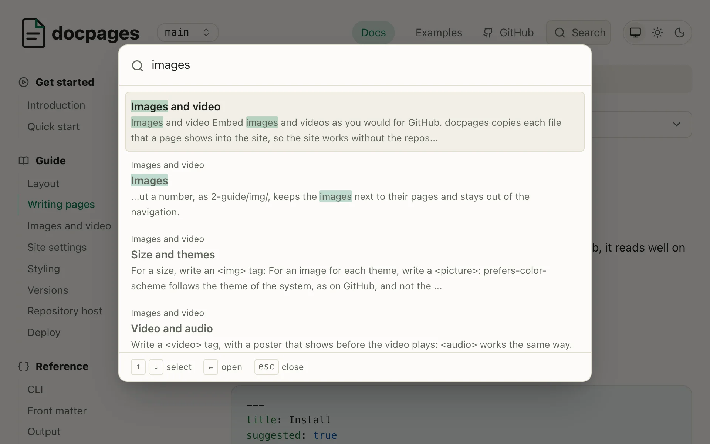
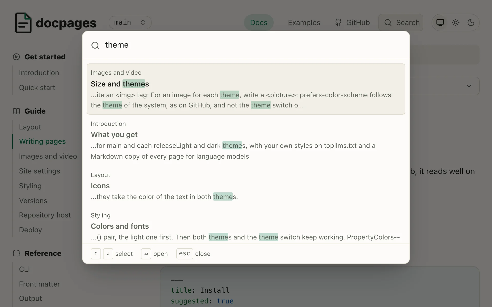

# Images and video

Embed images and videos as you would for GitHub. docpages copies each file that a page shows into the site, so the site works without the repository.

## Images

Write a Markdown image with a path relative to the Markdown file:

```markdown

```


- The file can be anywhere in the repository, as `../../assets/logo.webp`.
- A file that doesn't exist fails the build, as a dead link does.
- A URL, as `https://img.shields.io/badge/docs-latest-green`, stays as it is.

A folder without a number, as `2-guide/img/`, keeps the images next to their pages and stays out of the navigation.

## Size and themes

docpages writes each image's file dimensions into the page, letting the browser reserve space while it loads so the text below stays in place. It reads PNG, JPEG, GIF, WebP and AVIF dimensions, plus SVG dimensions when `<svg>` has pixel `width` and `height` attributes. Images from other sites aren't sized automatically.

The reserved space for opaque images pulses while they load. PNG, WebP and AVIF files with transparent pixels don't pulse, nor do GIF or SVG files, because the effect would show through them.

To use another size, set `width` on an ``. The page adds a proportional `height`:

```html

```


For an image for each theme, write a `<picture>`:

```html
<picture>
  <source media="(prefers-color-scheme: dark)" srcset="img/search-dark.webp">
  
</picture>
```

<picture>
  <source media="(prefers-color-scheme: dark)" srcset="img/search-dark.webp">
  
</picture>

On the site, `prefers-color-scheme` follows the theme switch, and the theme of the system while the switch is on "System". On GitHub it follows the theme of GitHub.

## Responsive images

`srcset` offers the same image at several widths, and `sizes` tells the browser how wide the image shows. It loads the smallest file that is sharp on the screen. Here the 480 pixel file is 10 KB and the 1920 pixel one 81 KB:

```html

```


The text of a page is as wide as the screen up to 900px, and never wider than 54rem.

A `<picture>` can show another image on a small screen, as a screenshot of the layout of a phone. The browser takes the first `<source>` whose `media` holds, and the `` if none does:

```html
<picture>
  <source media="(max-width: 30rem) and (prefers-color-scheme: dark)"
    srcset="img/search-phone-dark.webp">
  <source media="(max-width: 30rem)" srcset="img/search-phone-light.webp">
  <source media="(prefers-color-scheme: dark)" srcset="img/search-dark.webp">
  
</picture>
```

<picture>
  <source media="(max-width: 30rem) and (prefers-color-scheme: dark)"
    srcset="img/search-phone-dark.webp">
  <source media="(max-width: 30rem)" srcset="img/search-phone-light.webp">
  <source media="(prefers-color-scheme: dark)" srcset="img/search-dark.webp">
  
</picture>

The theme switch changes only the `prefers-color-scheme` of a `media`, which leaves the width to pick the image. Narrow the window below 30rem to see the phone.

If a `<source>` image has different proportions from the ``, like the phone screenshot, docpages gives it its own width and height.

## Video and audio

Write a `<video>` tag with a `poster`. It appears before playback and sets the video's size:

```html
<video src="img/demo.mp4" poster="img/demo.webp" controls muted></video>
```

<video src="img/demo.mp4" poster="img/demo.webp" controls muted></video>

Write an `<audio>` tag the same way, without a `poster`:

```html
<audio src="img/demo.mp3" controls></audio>
```

<audio src="img/demo.mp3" controls></audio>

`<source>` works in both tags. It offers a file in more than 1 format, or with `media` a smaller one for a small screen. `<track>` adds captions, which browsers show only for a video. The browser plays the first `<source>` whose `media` holds and whose `type` it plays. It picks it once, as the video loads:

```html
<video poster="img/demo.webp" controls>
  <source media="(max-width: 30rem)" src="img/demo-480.mp4" type="video/mp4">
  <source src="img/demo.webm" type="video/webm">
  <source src="img/demo.mp4" type="video/mp4">
  <track src="img/demo.vtt" kind="captions" srclang="en"
    label="English" default>
</video>
```

<video poster="img/demo.webp" controls>
  <source media="(max-width: 30rem)" src="img/demo-480.mp4" type="video/mp4">
  <source src="img/demo.webm" type="video/webm">
  <source src="img/demo.mp4" type="video/mp4">
  <track src="img/demo.vtt" kind="captions" srclang="en"
    label="English" default>
</video>

> [!TIP]
> Videos make a repository large. A video hosted elsewhere works with its URL in `src`, as an image does.

## The HTML that pages keep

Of the HTML in your Markdown, the pages keep ``, `<picture>`, `<source>`, `<video>`, `<audio>` and `<track>`, with these attributes:

| For | Attributes |
| --- | --- |
| Files | `src`, `srcset`, `sizes`, `media`, `type`, `poster` |
| Text and size | `alt`, `title`, `width`, `height`, `align` |
| Loading | `loading`, `decoding`, `preload` |
| Playback | `controls`, `autoplay`, `loop`, `muted`, `playsinline` |
| Captions | `kind`, `srclang`, `label`, `default` |

A `<details>` with its `<summary>` stays too, with `open`: see [Details](2-writing.md#details).

Other HTML, other attributes, such as `style` and `onerror`, and a `javascript:` URL fail the build, which names the file and the line. So does a `<p align="center">` around an image: write the image alone. An HTML comment passes. See [Checks](../3-reference/5-checks.md).

## In the site

Each version holds a copy of each file in `media/`, in a folder named after the content of the file, as `main/media/3f2a9c1be07d4e58/search.webp`. 2 files with the same name don't collide, and a changed file gets a new URL, which no browser cache holds. The page and its [Markdown copy](../3-reference/3-output.md) lead to the copy.

A [release](7-versions.md) keeps its own copies. `-snapshot` copies the files that its pages show: those in the docs folder keep their place, and the others go into `media/` of the release.
