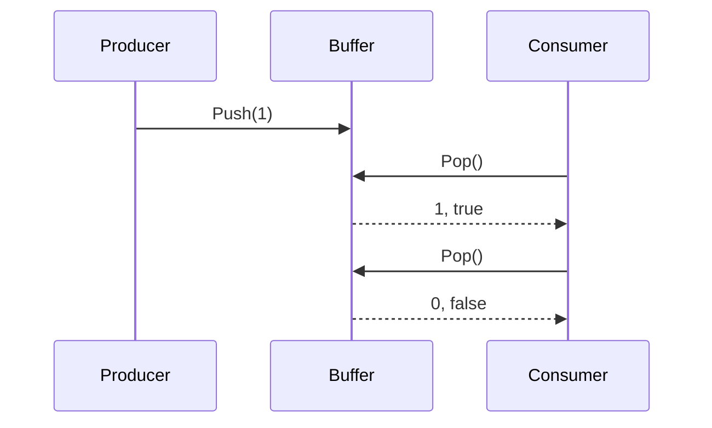

# Concurrency

A buffer is safe for 1 goroutine that pushes and 1 that pops at the same time. Neither waits for the other: [Push](../2-reference/README.md#push) fails on a full buffer and [Pop](../2-reference/README.md#pop) on an empty one.

> [!CAUTION]
> 2 goroutines that both push race. Give each its own buffer or guard the calls with a mutex.
